<!--
  README de perfil de GitHub · Yuleimis Baltazar
  Sube este archivo junto a: banner.svg, arya-circle.png y arya.jpg
  al repositorio: yuleimisbaltazar5-dotcom/yuleimisbaltazar5-dotcom
-->

 

---

## 🐺 Sobre mí

<table>
  <tr>
    <td width="250" align="center" valign="top">
      
       
      <em>«No hoy.»</em>
    </td>
    <td valign="top">
      

        Soy <b>Yuleimis Baltazar</b>, tengo <b>18 años</b> y vivo en
        <b>El Bagre, Antioquia (Colombia)</b>. Estudio <b>Técnico en Programación de Software</b>
        en el <b>SENA</b> (ficha <b>3412544</b>) y me formo como desarrollador <b>full-stack</b>.
      

      <ul>
        <li>💻 <b>Full-stack en formación:</b> PHP · MySQL · JavaScript · Python</li>
        <li>🎓 <b>SENA</b> — Técnico en Programación de Software, ficha 3412544</li>
        <li>📍 <b>El Bagre, Antioquia</b> — Colombia</li>
        <li>🌱 <b>Explorando:</b> Linux · n8n · automatización</li>
        <li>🎯 <b>Enfoque:</b> software útil para instituciones y problemas reales</li>
        <li>🐺 <b>Mentalidad:</b> disciplina, constancia y aprender construyendo</li>
      </ul>
      

        
          Me identifica Arya: curiosa, directa y entrenando todos los días para ser mejor.
          Cada proyecto es una nueva lección y una nueva forma de afilar la espada.
        
      

    </td>
  </tr>
</table>

---

## 🗡️ En este momento

> **Construyo software para problemas reales.**
>
> Hoy desarrollo una plataforma web para instituciones que permite **evaluar proyectos con mayor facilidad** y **enviar guías**, pensada para **instructores, profesores y aprendices del SENA (ECT)**.

<table>
  <tr>
    <td valign="top" width="50%">
      <h4>📋 Qué resuelve</h4>
      <ul>
        <li>Evaluaciones de proyectos centralizadas, claras y trazables.</li>
        <li>Envío de guías y material de apoyo en un solo lugar.</li>
        <li>Roles diferenciados para instructores, profesores y aprendices.</li>
        <li>Menos planillas sueltas y más tiempo para enseñar y aprender.</li>
      </ul>
    </td>
    <td valign="top">
      <h4>🧩 Con qué lo construyo</h4>
      

        
        
        
        
      

      

        
        
      

    </td>
  </tr>
</table>

---

## ⚙️ Tecnologías y herramientas

**Lenguajes y datos**

**Desarrollo web**

**Herramientas**

**Explorando ahora**

---

## 📊 Estadísticas de GitHub

 

---

### ⚔️ «No hoy.» 🐺

<b>Valar Morghulis.</b> El norte recuerda… y el código también.

  

  

Hecho con 🩸 y código en El Bagre, Antioquia · Colombia

